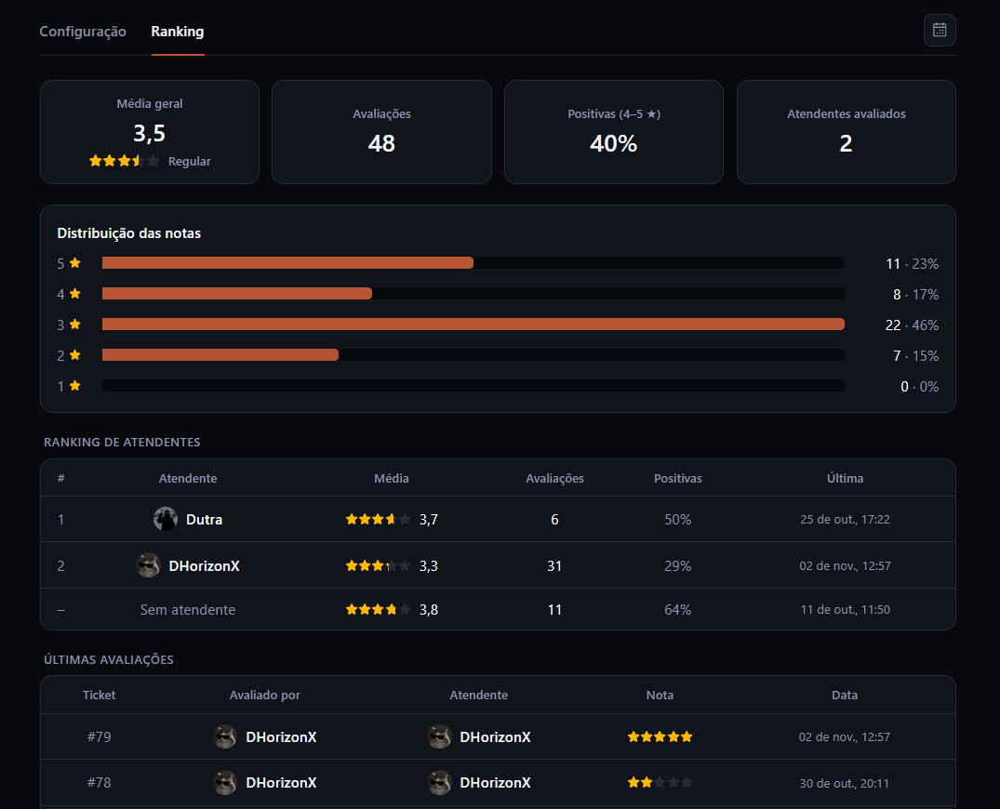

Oi, eu sou o Daniel.

Faço bots de Discord e os sites que vêm junto com eles. Hoje quase todo o meu tempo vai para o [Horizon Tool](https://horizontool.xyz), um bot de tickets que eu escrevo sozinho: o bot, o painel, o banco e a [documentação](https://docs.horizontool.xyz). Também cuido da DH Soluções.

Escrevo quase tudo em TypeScript. No bot uso Discord.js, no painel Next.js, e por baixo Prisma com Postgres.

[horizontool.xyz](https://horizontool.xyz) · [discord](https://discord.com/users/728615034732675112)
